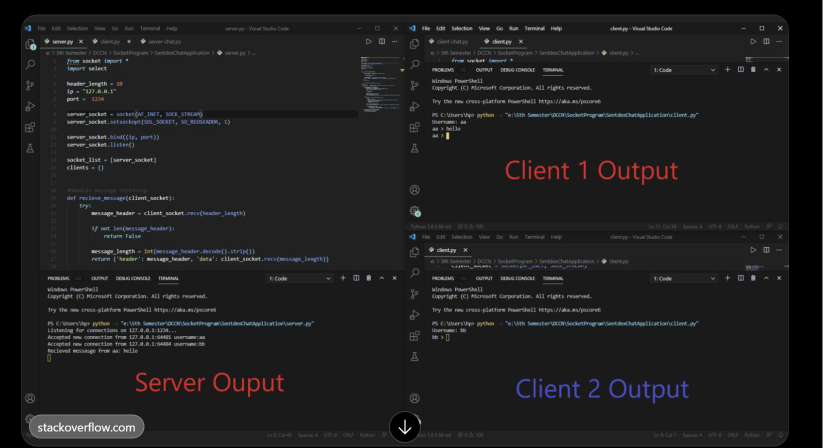

# Practical No. 10 – Group Communication

**Aim:** To implement group communication using a TCP server and multiple clients.

This practical demonstrates how multiple client programs connect to one server. A client sends a message to the server, and the server forwards (broadcasts) that message to every other connected client.

## Files in this folder

| File | Purpose |
|---|---|
| `server.py` | Starts the TCP server, accepts client connections, receives messages, and broadcasts them to the other clients. |
| `client.py` | Connects to the server, sends messages, and displays messages received from other clients. Run this file in separate terminals to start multiple clients. |

| `practical10_reference_screenshot.png` | Reference screenshot showing a server terminal and two client terminals. Your actual terminal output may look slightly different. |

## Requirements and dependencies

- Python **3.8 or newer**.
- Visual Studio Code or another editor/terminal (optional; Python can also be run from a normal terminal).
- A local computer for the basic demonstration.
- The program uses only Python's standard-library modules: `socket` and `threading`.

**No external libraries are required. No `pip install` command is needed.** Do not install `socket` or `threading` separately; they are included with Python.

Check that Python is installed:

```bash
python --version
```

On Windows, this command may also be available:

```powershell
py --version
```

## How to run the practical

### Step 1: Extract and open the folder

1. Extract `practical_10_group_communication.zip`.
2. Open the extracted `practical_10_group_communication` folder in Visual Studio Code, or open a terminal in that folder.
3. Make sure `server.py` and `client.py` are in the same folder.

### Step 2: Start the server

Open **Terminal 1** and run:

```bash
python server.py
```

On Windows, use this command if `python` is not recognized:

```powershell
py server.py
```

Keep this terminal running. The server listens on port `12345` and waits for client connections.

### Step 3: Start Client 1

Open **Terminal 2** in the same folder and run:

```bash
python client.py
```

### Step 4: Start Client 2

Open **Terminal 3** in the same folder and run the same command:

```bash
python client.py
```

You can start additional clients by opening more terminals and running `python client.py` in each one.

### Step 5: Test group communication

1. Type a message in Client 1 and press Enter.
2. The server displays the received message.
3. The other connected clients (for example, Client 2) receive the message.
4. Send a message from Client 2 and check that Client 1 receives it.
5. In a client terminal, type `exit` and press Enter to disconnect that client.
6. In the server terminal, press `Ctrl+C` to stop the server after testing.

**Note:** The server forwards each message to all other connected clients, not back to the client that sent it. This is the broadcast behaviour implemented by this program.

## Network configuration

The default configuration is for running the server and all clients on the **same computer**:

- Server bind address: `0.0.0.0`
- Client address: `127.0.0.1`
- TCP port: `12345`

To run clients on other computers on the same local network:

1. Find the server computer's local IPv4 address.
2. In `client.py`, change `HOST = "127.0.0.1"` to the server computer's local IPv4 address, for example `HOST = "192.168.1.10"` (use your actual address, not this example).
3. Start the server on the server computer and the clients on the client computers.
4. Allow incoming TCP traffic on port `12345` in the server computer's firewall, if prompted or required.

All computers must be connected to a network that permits them to communicate. The example is intended for a trusted local network, not direct exposure to the public internet.

## Troubleshooting

| Problem | What to check |
|---|---|
| `Could not connect` appears in a client | Start `server.py` first; check the server address and port. |
| `Address already in use` appears on the server | Stop the other program using port `12345`, or choose another unused port and update it in both files. |
| Clients do not receive each other's messages | Make sure at least two clients are connected to the same server and that the server terminal is still running. |
| `python` is not recognized on Windows | Try `py server.py` or `py client.py`; verify that Python is installed. |

## Implementation summary

- `socket` creates TCP connections between the server and clients.
- `threading` allows the server to handle multiple client connections and allows each client to receive messages while the user is typing.
- The server keeps track of connected clients and broadcasts each received message to the other clients.
- A client disconnects by entering `exit`.

## Reference screenshot

The following image was supplied as a reference for the practical's three-terminal arrangement (server, Client 1, and Client 2). It is included for guidance; the exact code and terminal messages in the screenshot may differ from this Python implementation.


